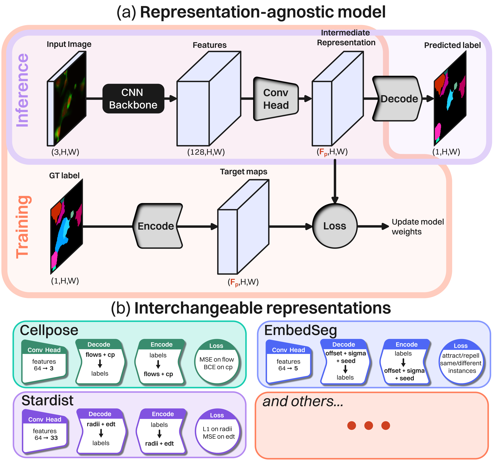

# PluriSeg
_A Representation-Agnostic Framework to Benchmark and Select Instance Segmentation Representations for Microscopy Images_

This is a placeholder repo while the code is being cleaned up

## Architecture

_Representation-agnostic architecture (a), with interchangeable instance representation blocks (b). The framework can learn and predict any representation from its pool._