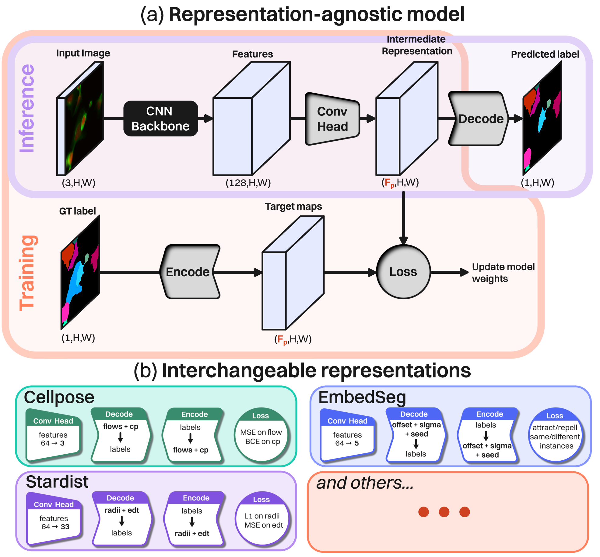

# PluriSeg
_A Representation-Agnostic Framework to Benchmark and Select Instance Segmentation Representations for Microscopy Images_

This is the code to reproduce the results presented in our ISBI 2027 submitted paper. Code is pending further cleanup and refactor for easier usage.

## Installation

The project runs in a [pixi](https://pixi.prefix.dev/latest/installation/) workspace: `pixi install` creates the environment from the committed `pixi.lock` (PyTorch GPU on machines with an NVIDIA driver, CPU otherwise), and `pixi run` executes commands inside it:

```bash
pixi install
pixi run python -m pluriseg --help
```

## Representations

| 🌟 Representation | 💾 Implementation repository | 🧑‍💻 Code | 📑 Paper |
| --- | --- | --- | --- |
| Masks (with gaps) | (no official repo) | [MaskRep](src/pluriseg/representations/mask.py) | [Ronneberger 2015](https://link.springer.com/chapter/10.1007/978-3-319-24574-4_28) |
| Cellpose | https://github.com/MouseLand/cellpose | [CellposeRep](src/pluriseg/representations/cellpose.py) | [Stringer 2021](https://www.nature.com/articles/s41592-020-01018-x) |
| StarDist | https://github.com/stardist/stardist | [StarDistRep](src/pluriseg/representations/stardist.py) | [Schmidt 2018](https://link.springer.com/chapter/10.1007/978-3-030-00934-2_30) |
| Omnipose | https://github.com/kevinjohncutler/omnipose/tree/v1.1.4 | [OmniposeRep](src/pluriseg/representations/omnipose.py) | [Cutler 2022](https://www.nature.com/articles/s41592-022-01639-4) |
| EmbedSeg | https://github.com/juglab/EmbedSeg | [EmbedsegRep](src/pluriseg/representations/embed.py) | [Lalit 2021](https://proceedings.mlr.press/v143/lalit21a.html) |

## Architecture


_Representation-agnostic architecture (a), with interchangeable instance representation blocks (b). The framework can learn and predict any representation from its pool._

## Terminology

Paper and code use different names for the same concepts; unification is pending:

| paper | code |
|---|---|
| Head selector | Gate (`GateRouter`, refit after fit) |
| Hybrid | Chimera (`ChimeraRep`) |
| PluriSeg model | `UnifiedSegmentationModel` (currently `UnifedSegmentationModel`, rename pending) |

## Usage

Splits are generated once per dataset from the dataset root and committed with the repo — adding images never silently reshuffles an existing split (regeneration is deliberate, `--overwrite true`):

```bash
python -m pluriseg make_train_test_split --config configs/splits/splits_cis_cellpose.yaml
```

Each `configs/splits/*.yaml` maps 1:1 onto the function signature. Splits live in `data-splits/<dataset_name>/` as `fold-<k>.yaml` (`{train, val, test}` lists of `[image, label, cache_id]`) plus a `manifest.yaml` recording seed, patterns and what dedup dropped (`dedup: true` removes byte-identical images and train/test leaks; test = the official `<test_dir>/`, val = a seeded `val_fraction` of `<train_dir>/`, single `fold-0.yaml`, `n_folds: 1`).

Training/eval configs consume a split by name (see `configs/data/*.yaml`): `root`, `split_name`, `fold`, `n_folds` (must match the manifest). Datasets live at `data/<name>/` as declared in those configs — place the images there or override with `--data.root <path>`.

Protocol: `configs/train/base.yaml` (small-128 backbone, patch 384, batch 8, 600 ep × 50 batches/ep, monitor `val_pq`) on the five CIS datasets — five single representations plus chimera with the post-refit gate — seeded via `--train.seed_everything`.

```bash
# single representations (5 datasets × cellpose embed mask omnipose stardist)
python -m pluriseg fit --config configs/train/base.yaml \
    --data configs/data/cis_cellpose.yaml --rep configs/rep/cellpose.yaml \
    --data.fold 0 --backbone.in_ch 3 --train.check_val_every_n_epoch 8 \
    --train.seed_everything 0

# chimera + post-refit gate (router refits after fit; eval runs automatically)
python -m pluriseg fit --config configs/train/base.yaml \
    --data configs/data/cis_cellpose.yaml --rep configs/rep/chimera.yaml \
    --data.fold 0 --backbone.in_ch 3 --train.check_val_every_n_epoch 8 \
    --train.seed_everything 0 --gate configs/train/gate.yaml
```

Per-dataset overrides — swap `cis_cellpose` and its values in the commands above for any other row (`check_val_every_n_epoch` equalizes total val decode work):

| dataset | split config | in_ch | check_val_every_n_epoch |
|---|---|---|---|
| cis_cellpose | splits_cis_cellpose.yaml | 3 | 8 |
| cis_dsb2018 | splits_cis_dsb2018.yaml | 3 | 6 |
| cis_livecell | splits_cis_livecell.yaml | 1 | 38 |
| cis_omnipose | splits_cis_omnipose.yaml | 1 | 4 |
| cis_tissuenet | splits_cis_tissuenet.yaml | 2 | 58 |

Repeats = rerun with a new seed value. Standalone re-eval of a run: `python -m pluriseg eval --ckpt_path runs/...`.
